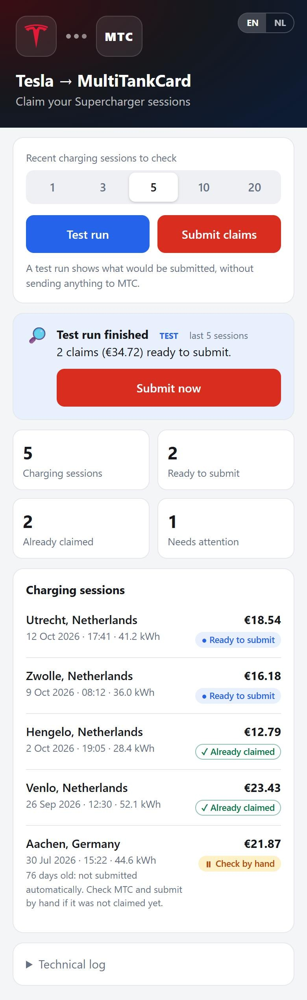

# Tesla MTC Integration

[](https://github.com/WesSec/tesla_mtc/actions/workflows/validate.yml)
[](https://github.com/WesSec/tesla_mtc/releases/latest)
[](LICENSE)

Project Status: Created by @WesSec. Active maintenance, issue triage, and releases are now led by @Jochemp88.

Automatically submit Tesla charging sessions to MultiTankCard (MTC) for reimbursement. This tool integrates with both Tesla's API to fetch your charging sessions and MTC's reimbursement system to automate the submission process.

⚠️ **Use at your own risk:** Wrongfully submitting reimbursements could be seen and punished as fraud. Always verify that submissions match your actual charging sessions. ⚠️

### Security Notice

Never commit your `.env` file or share your:

- Tesla refresh token/credentials
- MTC credentials
- IBAN number 
- Vehicle VIN

[](https://ko-fi.com/B6B328TZSX)

## How It Works

1. Fetches recent charging sessions from your Tesla account.
2. Processes charging data, handling both Dutch and supported foreign country invoices.
3. Checks for duplicate submissions in your MTC history to prevent re-submitting.
4. For unknown countries, it prompts you to decide whether to submit as a Dutch invoice or skip.
5. Submits reimbursement claims with the required invoice PDF attached.

## Setup

1. Clone this repository
2. Copy `.env.example` to `.env`
3. Fill in your credentials and preferences in `.env`
4. Install required packages:

   ```bash
   pip install -r requirements.txt
   sudo apt install poppler-utils
   ```

## Web Interface (optional)



Prefer tapping a button over running a script? The web interface runs tesla_mtc in Docker (for example on a Synology NAS) and lets you start it from your phone or Home Assistant:

- test run first, then submit after a confirmation;
- one card per charging session showing whether it is ready to submit or already claimed;
- choose how many recent sessions to check;
- English and Dutch, light and dark mode;
- submitting stays switched off until you enable it.

Quick start with Docker Compose, using the ready-made image `ghcr.io/wessec/tesla_mtc` (amd64 and arm64), so you don't need the source code:

```bash
mkdir tesla_mtc && cd tesla_mtc
curl -fsSLo docker-compose.yml https://raw.githubusercontent.com/WesSec/tesla_mtc/main/docker-compose.example.yml
curl -fsSLo .env https://raw.githubusercontent.com/WesSec/tesla_mtc/main/.env.example   # then fill it in
touch skip.txt
docker compose up -d              # open http://<your-server>:8080
```

See **[docs/web-runner.md](docs/web-runner.md)** for the full setup (including Synology Container Manager), updating, a first-use walkthrough with screenshots, and Home Assistant examples.

<br clear="right">

## Environment Variables

### Required Settings

- `TESLA_VIN`: Your Tesla vehicle identification number
- `TESLA_REFRESH_TOKEN`: Tesla API refresh token (see below)
- `IBAN`: Your bank account number for reimbursement payouts
- `MTC_USERNAME`: MTC platform username
- `MTC_PASSWORD`: MTC platform password
- `MODE`: Set to 'DRY' for testing (no actual submissions, anything !DRY will actually submit)

### Optional Settings

- `LOG_LEVEL`: App logging level (default: INFO)
- `MAX_SESSIONS`: Number of recent charging sessions to process (default: 1)
- `DEVICE_COUNTRY`: Country code (default: NL)
- `DEVICE_LANGUAGE`: Language code (default: nl)
- `TTP_LOCALE`: Locale setting (default: nl_NL)
- `UNKNOWN_COUNTRY_ACTION`: How to handle invoices from unknown countries. Use `SKIP` for automated/NAS environments, `PROMPT` for interactive, or `DUTCH` to force as local (default: PROMPT).
- `LOOKBACK_PERIOD`: Months of MTC history searched for earlier claims (default: 6). The check always reaches back far enough to cover the session being processed.
- `MTC_MAX_RECORDS`: Maximum number of MTC transactions fetched for the duplicate check (default: 400). MTC returns exactly this many, newest first, without pagination, so it must cover your whole `LOOKBACK_PERIOD`. When the maximum is reached, a warning is logged and sessions older than the oldest returned transaction are reported instead of submitted.
- `MAX_SESSION_AGE_DAYS`: Sessions older than this are never submitted automatically, only reported, because MTC claims cannot be withdrawn (default: 60, `0` disables the limit).

## ⚠️ Notice on Foreign Currencies

This tool automatically skips charging sessions billed in currencies other than Euros (EUR) (e.g., GBP in the UK). Because MTC processes all claims as EUR, submitting foreign currencies leads to incorrect payouts. These invoices must be converted and declared manually.

## Getting Your Tesla Refresh Token

https://tesla-info.com/tesla-token.php

## Features

- **Duplicate Detection**: Automatically checks both the `ClaimNote` (Toelichting) and `Note` (Notities) fields in your MTC transaction history for the Tesla charging session ID to prevent duplicate submissions. (Tip: If you manually declare an invoice, paste the Tesla Session ID into the MTC Note field to ensure the script ignores it!).
- **Manual Override (Skip List)**: Create a `skip.txt` file in the root directory and paste the Tesla `chargeSessionId`s you want to ignore (one per line). The script will bypass them.
- **Foreign Currency Handling**: Automatically detects and skips foreign currency invoices (e.g., GBP) to prevent incorrect EUR payouts, prompting you to declare them manually.
- **Dry Run Mode**: Test the system and view planned submissions without actually sending claims to MTC (set `MODE=DRY` in your `.env`).

## Versioning

This project follows [Semantic Versioning](https://semver.org). The current version is in `version.py`, is logged at startup, and every release is tagged as `v<version>` with its changes listed in [CHANGELOG.md](CHANGELOG.md).

## Development

Every push and pull request is checked automatically (lint, unit tests and a Docker build with a short smoke test, see [.github/workflows/validate.yml](.github/workflows/validate.yml)). The tests use fictional data and never contact Tesla or MTC. To run the same checks locally:

```bash
pip install -r requirements-dev.txt
ruff check .
pytest
```

### Releasing

1. Bump `version.py` and give the version a dated entry in `CHANGELOG.md` (`## [1.2.3] - 2026-01-31`).
2. Merge to `main`, then tag and push: `git tag -a v1.2.3 -m "tesla_mtc 1.2.3" && git push origin v1.2.3`.
3. The [Publish image](.github/workflows/publish.yml) workflow checks that the tag, `version.py` and the changelog agree, runs a smoke test, and publishes `ghcr.io/wessec/tesla_mtc` for amd64 and arm64 with the tags `1.2.3`, `1.2`, `1` and `latest` (the last two only for the newest release).
4. Create the GitHub release with the changelog entry as release notes.

To publish an existing release again, for example to pick up security updates of the base image, run **Actions → Publish image → Run workflow** with its tag (1.2.1 or later).

## Error Handling

The system includes error handling:
- Checks for API-level errors in responses
- Validates submissions before processing

## Troubleshooting

If you encounter issues:
1. Check your `.env` configuration
2. Verify your MTC credentials
3. Ensure your Tesla refresh token is valid
4. Review logs for detailed error messages
5. Try running in DRY mode first
