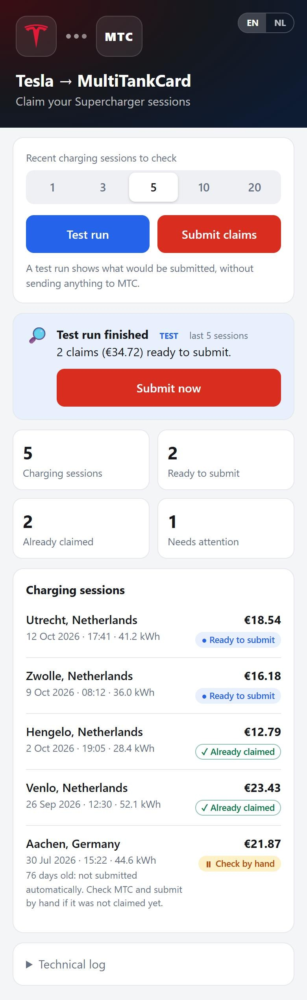
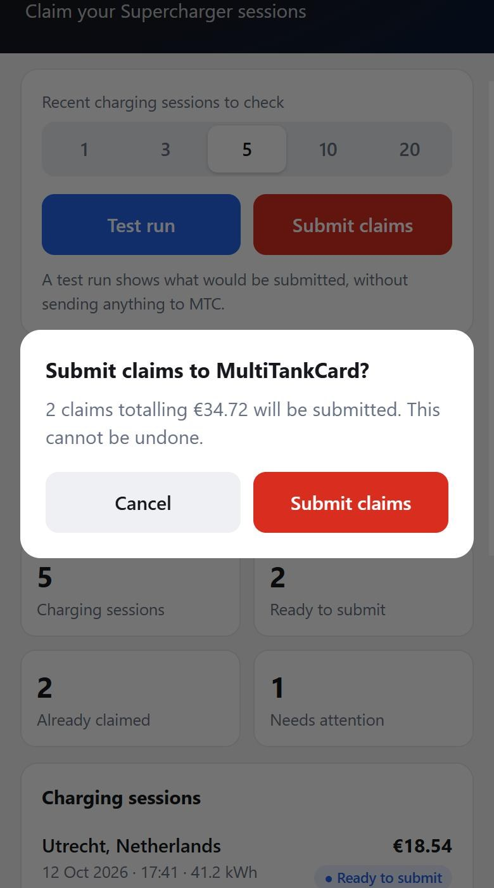
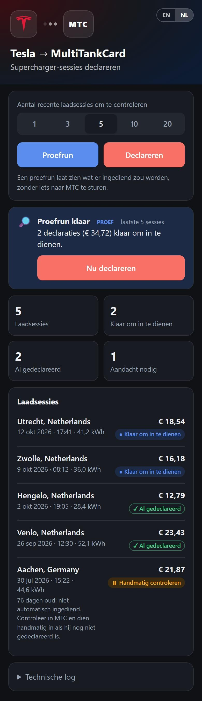
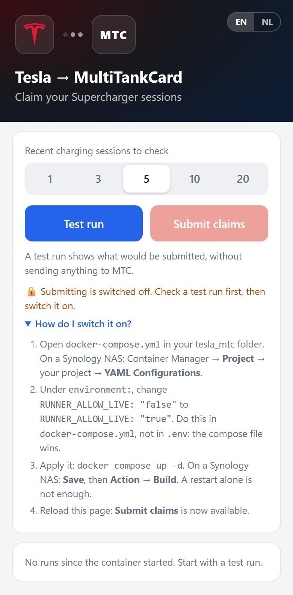
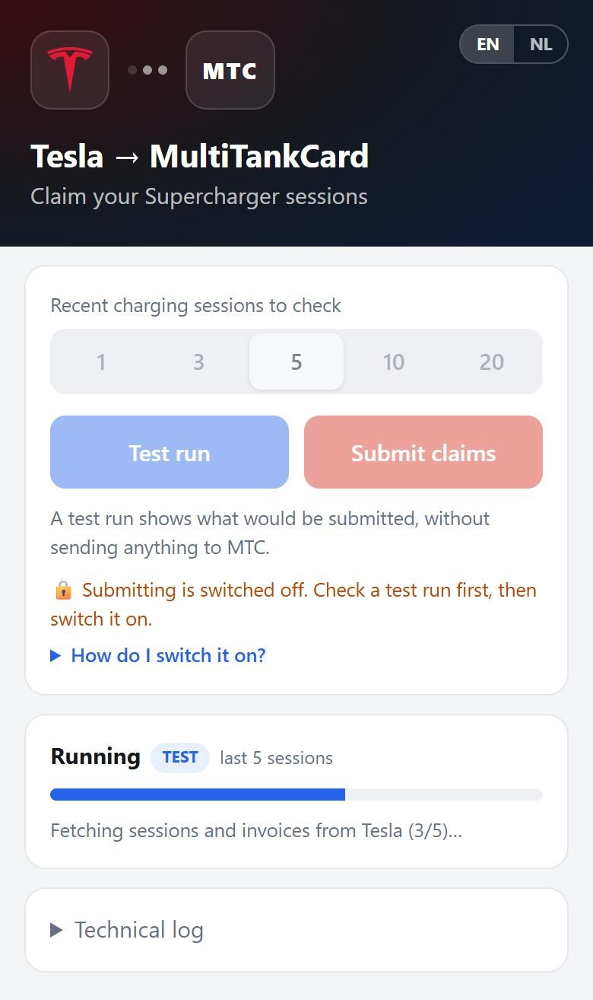
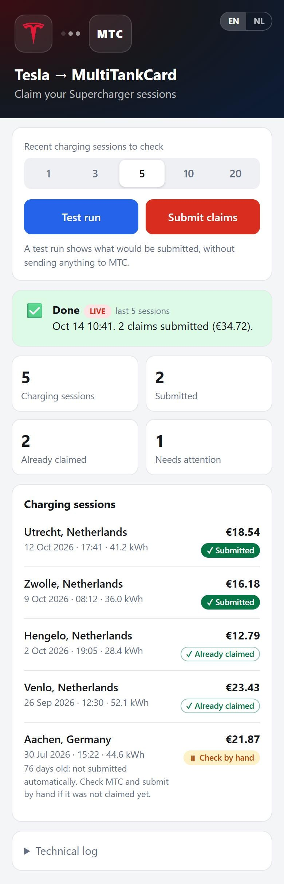

# Web interface

A small web page to start tesla_mtc from your phone and see a readable result. It runs next to tesla_mtc in the same container. It has no extra dependencies: only the Python standard library.

<p>
  
  
  
</p>

**What it gives you**

- **Start a run with one tap**, from your phone or Home Assistant. The container keeps running between runs, so Docker or Synology no longer reports a "stopped unexpectedly" container after every run.
- **Test run first, submit after confirming.** A test run shows exactly what would be submitted; submitting always asks for confirmation.
- **A readable result:** one card per charging session with its status, instead of a raw log.
- **Choose how many recent sessions to check** for each run.
- **English and Dutch**, following the phone's language, plus light and dark mode.
- **Safe by default:** submitting is switched off until you enable it.

## Contents

- [Before you start](#before-you-start)
- [Setup with Docker Compose](#setup-with-docker-compose)
- [Setup on a Synology NAS](#setup-on-a-synology-nas-container-manager)
- [Setup without Docker](#setup-without-docker)
- [First use](#first-use)
- [What the statuses mean](#what-the-statuses-mean)
- [Settings](#settings)
- [Access from outside your home](#access-from-outside-your-home)
- [Home Assistant](#home-assistant)
- [Updating](#updating)
- [Troubleshooting](#troubleshooting)

## Before you start

You need:

- A filled-in `.env` file with your Tesla and MTC details. Copy `.env.example` to `.env` and follow the [main README](../README.md#environment-variables). The `MODE` setting in `.env` is ignored by the web interface: the button you press decides between a test run and submitting.
- **Docker with Docker Compose**, or **Synology Container Manager**, or Python 3.10+ with `poppler-utils` if you run it without Docker.

> ⚠️ MTC claims **cannot be withdrawn** once submitted. Always start with a test run and check the result before you enable submitting.

## Setup with Docker Compose

1. Get the code: clone the repository, or download the ZIP of the [latest release](https://github.com/WesSec/tesla_mtc/releases/latest) and extract it.
2. In that folder, create your settings and an (empty) skip list:

   ```bash
   cp .env.example .env
   touch skip.txt
   cp docker-compose.example.yml docker-compose.yml
   ```

   Then fill in `.env`. Create `skip.txt` even if you don't use it: otherwise Docker creates a *folder* with that name.
3. Build and start:

   ```bash
   docker compose up -d --build
   ```

4. Open `http://<address-of-your-server>:8080` in your browser, and continue with [First use](#first-use).

## Setup on a Synology NAS (Container Manager)

1. Download the ZIP of the [latest release](https://github.com/WesSec/tesla_mtc/releases/latest).
2. In **File Station**, upload the ZIP to the `docker` shared folder, right-click it and choose **Extract → Extract here**. This creates a folder such as `docker/tesla_mtc-1.2.0`. Rename that folder to `tesla_mtc` and delete the ZIP.
3. Prepare three files on your computer and upload them into `docker/tesla_mtc`, next to `main.py`:
   - `.env`: a copy of `.env.example` with your details filled in.
   - `skip.txt`: an empty text file.
   - `docker-compose.yml`: a copy of `docker-compose.example.yml` from the ZIP. Check that it says `build: .` and does not mention any other folder. A compose file from an older tesla_mtc setup will not work here.

   File Station hides files starting with a dot. If you can't find `.env` after uploading, enable hidden files in File Station's settings.
4. Open **Container Manager → Project → Create**:
   - **Project name:** `tesla_mtc`
   - **Path:** the folder from step 2
   - **Source:** *Use existing docker-compose.yml*

   Click **Next** and **Done**. Container Manager builds the image and starts the container; the first build takes a few minutes.

   Container Manager may store your `docker-compose.yml` as **`compose.yaml`** in the same folder. That is normal and the contents stay the same. From then on, edit it through Project → `tesla_mtc` → **YAML Configurations**, which always shows the file the project uses.
5. Open `http://<address-of-your-NAS>:8080`, and continue with [First use](#first-use).

If port 8080 is already in use on your NAS, change the left number in `docker-compose.yml`, for example `"8085:8080"`, and open that port instead.

Already running tesla_mtc in another container and want to try this next to it? Use a separate folder, a different `container_name` and a different port in `docker-compose.yml`, and leave `RUNNER_ALLOW_LIVE` on `"false"` so only one setup can submit.

## Setup without Docker

```bash
pip install -r requirements.txt
sudo apt install poppler-utils     # Windows/macOS: install poppler and add it to PATH
python web/runner.py
```

Then open `http://localhost:8080`. Settings from the [table below](#settings) can be set as environment variables. Keep the window open: the page only works while `web/runner.py` is running.

## First use

### 1. Open the page



Submitting is still switched off (the 🔒 note). That is intentional: first check that a test run gives the result you expect. *How do I switch it on?* shows the steps for later; they are also in [step 4](#4-switch-submitting-on).

The row of numbers sets **how many recent charging sessions are checked**. Choose enough to cover everything since your last claim. Already-claimed sessions are recognised and skipped, so checking a few too many is harmless. The default comes from `MAX_SESSIONS` in `.env`; after that the page remembers your last choice.

### 2. Do a test run

Tap **Test run**. Nothing is sent to MTC. The page shows the progress and updates by itself:



### 3. Check the result


At the top you see what would be submitted, followed by the totals and one card per charging session. Check that:

- the sessions marked **Ready to submit** have really not been claimed yet;
- the sessions you claimed before show **Already claimed**;
- you look into anything under **Needs attention** (see [What the statuses mean](#what-the-statuses-mean)).

The **Technical log** at the bottom shows tesla_mtc's own output, which helps when something goes wrong.

### 4. Switch submitting on

When the test run looks right, switch submitting on in **`docker-compose.yml`**. The page shows the same steps under *How do I switch it on?*.

1. Open `docker-compose.yml`:
   - **Docker Compose:** the file in your tesla_mtc folder;
   - **Synology:** Container Manager → **Project** → `tesla_mtc` → **YAML Configurations**.
2. Under `environment:`, change `"false"` to `"true"`:

   ```yaml
       environment:
         UNKNOWN_COUNTRY_ACTION: SKIP
         RUNNER_ALLOW_LIVE: "true"
   ```

   Change it here, **not in `.env`**. `docker-compose.yml` sets `RUNNER_ALLOW_LIVE` itself, and that value wins over the one in `.env`.
3. Apply the change:
   - **Docker Compose:** `docker compose up -d`
   - **Synology:** click **Save**, then **Action → Build**.

   A plain restart is not enough: the container has to be recreated to pick up the new setting.
4. Reload the page. The 🔒 note is gone and **Submit claims** is available.

To switch submitting off again, set it back to `"false"` the same way.

### 5. Submit

After a test run you can tap **Submit now** in the result, or **Submit claims** at the top. You always get a confirmation first:


If you use the same number of sessions as the last test run, the confirmation shows exactly how many claims and what amount will be submitted. With a different number it warns you that it can't know this in advance.

After submitting you see what was sent:



**From now on:** do a test run, check it, and submit. Submitting also checks for duplicates again, so tapping it twice does not claim a session twice.

## What the statuses mean

| Status | Meaning | What to do |
|---|---|---|
| ● **Ready to submit** | Not found in your MTC claims; would be submitted. | Check it, then submit. |
| ✓ **Submitted** | Submitted in this run. | Nothing. |
| ✓ **Already claimed** | MTC already has a claim with this session's ID. | Nothing. |
| ⏸ **Check by hand** | Not submitted automatically, for one of two reasons shown below the session: it is older than `MAX_SESSION_AGE_DAYS` (default 60 days) and not found in MTC, or MTC returned its maximum number of transactions (`MTC_MAX_RECORDS`) and this session is older than all of them, so duplicates could not be checked. | Check in MTC. If it was really not claimed, submit it by hand. Otherwise raise `MAX_SESSION_AGE_DAYS` or `MTC_MAX_RECORDS`, or add the session ID to `skip.txt` to stop seeing it. |
| ✕ **Failed** | MTC refused the claim; the reason is shown below the session. | Read the reason; see the technical log. |
| ✕ **No invoice** | Tesla had no invoice for this session (yet). | Try again later. |

Sessions in `skip.txt` and sessions in a currency other than EUR are left out of the list; the **Messages** section mentions them.

## Settings

Web interface settings, set under `environment:` in `docker-compose.yml`:

| Setting | Default | Meaning |
|---|---|---|
| `RUNNER_ALLOW_LIVE` | `false` | `true` enables submitting; see [Switch submitting on](#4-switch-submitting-on). Test runs always work. |
| `RUNNER_TOKEN` | *(empty)* | When set, the page only opens with `?token=<value>` in the URL, and API calls need the header `Authorization: Bearer <value>`. |
| `RUNNER_PORT` | `8080` | Port inside the container. To change the port on your server, change the left number under `ports:` instead. |
| `TZ` / `RUNNER_TZ` | `Europe/Amsterdam` | Time zone for times on the page. |
| `RUNNER_CMD` | `python -u main.py` | Command for a run. Only change this to wrap tesla_mtc in your own script. |
| `RUNNER_APP_DIR` | the repository folder | Folder `RUNNER_CMD` runs in. |

tesla_mtc's own settings in `.env` keep working. The most relevant ones here:

- `MAX_SESSIONS`: the default number of sessions in the picker.
- `MAX_SESSION_AGE_DAYS`: when sessions get **Check by hand**.
- `MTC_MAX_RECORDS`: how many MTC transactions the duplicate check reads.
- `UNKNOWN_COUNTRY_ACTION`: the example compose file sets this to `SKIP`, since nobody can answer questions inside a container.

A custom MTC logo can be shown in the header: place `mtc-logo.svg`, `.png` or `.webp` in the `web` folder and restart.

## Access from outside your home

The page can submit claims in your name. **Do not open it to the internet** through port forwarding. Use a VPN to your home network instead (WireGuard, Tailscale, or your router's or NAS's VPN), and add a `RUNNER_TOKEN` for extra protection.

Built-in protection:
- **Requests from other websites are refused.** A page you visit elsewhere cannot start a run through your browser. Home Assistant and other direct API calls are not affected.
- **The page cannot be embedded** in another site's frame.
- **The token is compared in constant time** and never written to a log.

On your phone, open the page and choose *Add to Home screen* for an app-like icon.

## Home Assistant

Start a test run from Home Assistant (`configuration.yaml`):

```yaml
rest_command:
  tesla_mtc_test_run:
    url: "http://<address>:8080/run?mode=DRY&sessions=5"
    method: post
  tesla_mtc_submit:
    url: "http://<address>:8080/run?mode=LIVE&sessions=5"
    method: post
```

If you set a `RUNNER_TOKEN`, add to each command:

```yaml
    headers:
      Authorization: "Bearer <your token>"
```

Show the last result with a REST sensor:

```yaml
sensor:
  - platform: rest
    name: Tesla MTC
    resource: "http://<address>:8080/status"
    value_template: "{{ value_json.would_submit }}"
    json_attributes: [running, mode, finished, ok, submitted, duplicates, too_old, failed, amount_would_submit]
    scan_interval: 300
```

`/status` returns JSON such as:

```json
{"running": false, "mode": "DRY", "max_sessions": 5, "finished": "2026-10-14T10:41:35+02:00", "ok": true,
 "sessions": 5, "submitted": 0, "would_submit": 2, "duplicates": 2, "too_old": 1, "failed": 0,
 "amount_would_submit": 34.72, "allow_live": true}
```

Submitting through the API needs `RUNNER_ALLOW_LIVE=true` and skips the confirmation. Be careful with automations that submit without you checking a test run first.

## Updating

- **Docker Compose:** `git pull` (or extract the new release over the old folder, keeping `.env`, `skip.txt` and `docker-compose.yml`), then `docker compose up -d --build`.
- **Synology:** upload the new release files over the old ones (keep your `.env`, `skip.txt` and `docker-compose.yml` or `compose.yaml`), then Container Manager → Project → `tesla_mtc` → Action → **Build**. The release does not contain a `docker-compose.yml` or `compose.yaml`, only `docker-compose.example.yml`, so your own compose file is never overwritten.

After updating, do a test run and open the **Technical log**: its first lines show the version that actually ran (`tesla_mtc 1.2.0`). If it still shows the old version, the image was not rebuilt. On Synology, use Action → **Clean** and then **Build**. The release notes list what changed.

## Troubleshooting

| Problem | Solution |
|---|---|
| The page does not open | Check the container is running and the port under `ports:`. On a NAS, check the firewall allows the port. |
| **Submit claims** is greyed out with a 🔒 note | Submitting is off. Follow [Switch submitting on](#4-switch-submitting-on). Set it in `docker-compose.yml`, not `.env`, and rebuild rather than restart. |
| "Run failed" | Open the **Technical log** on the page. Common causes: an expired `TESLA_REFRESH_TOKEN`, or wrong MTC login details in `.env`. |
| Error about `skip.txt` / *Is a directory* | Docker created a folder because `skip.txt` did not exist. Remove the folder, create an empty `skip.txt` file and restart. |
| A session you claimed by hand is **Ready to submit** | Put its Tesla session ID in MTC's note field, or add it to `skip.txt`. |
| A warning about the maximum number of MTC transactions | Your `LOOKBACK_PERIOD` holds more MTC transactions than `MTC_MAX_RECORDS`. Older sessions are then shown as **Check by hand**. Raise `MTC_MAX_RECORDS` in `.env`, or lower `LOOKBACK_PERIOD`. |
| Times on the page are off | Set `TZ` in `docker-compose.yml`, for example `TZ: Europe/Amsterdam`. |
| Can't find `docker-compose.yml` on the NAS | Container Manager may have saved it as `compose.yaml`. Change settings through Project → `tesla_mtc` → **YAML Configurations**. |
| Changes to `.env` have no effect | Recreate the container: `docker compose up -d` (Synology: build the project again). A plain restart does not reload `.env`. |
